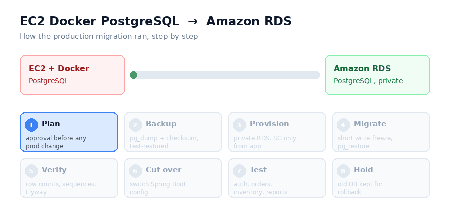
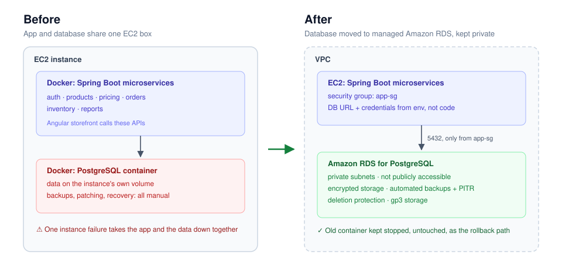
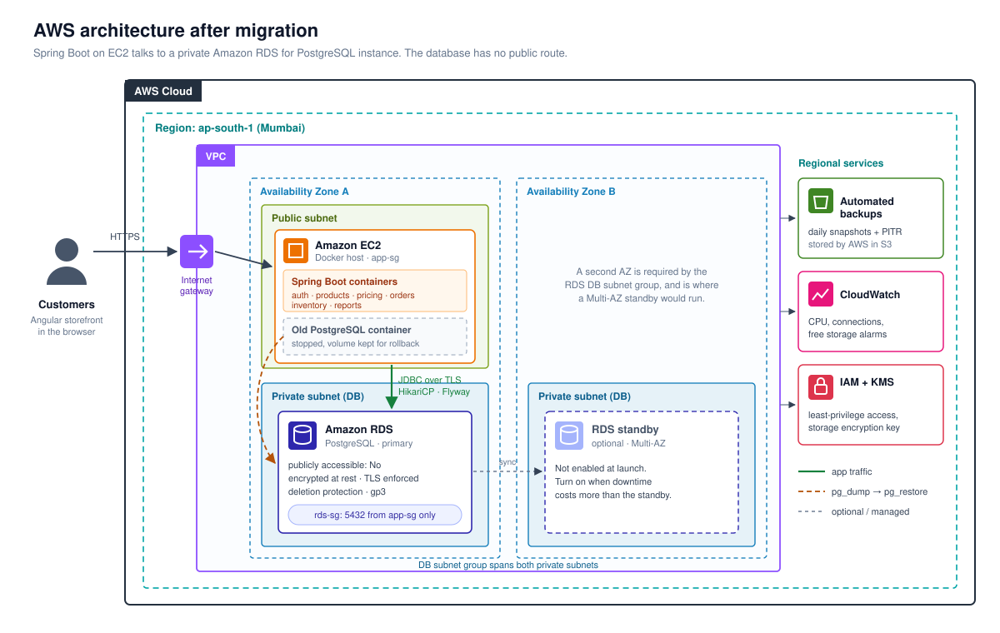

# Moving a live e-commerce database from a Docker container to Amazon RDS

A freelance project: I migrated a client's production PostgreSQL database from a Docker container on EC2 to Amazon RDS for PostgreSQL, without losing a single row and without ever exposing the database to the internet.

The client runs a live e-commerce platform (Angular storefront, Spring Boot microservices). The company and its data are under NDA, so everything here is sanitized: no hostnames, no credentials, no real table names beyond the generic modules. The approach, scripts and documents are the real ones I used.



---

## Why this needed to happen

The database lived in a container on the same EC2 instance as the application. It worked, but it meant:

- if that instance went down, the store and its data went down together
- backups were whatever someone remembered to run
- PostgreSQL patching, storage growth and recovery were all manual
- scaling the database meant scaling the whole box

The client wanted a managed database they could rely on and grow with, at a sensible cost, and they were very clear about the rules.

## The rules I worked under

These came from the client, and I treated them as hard constraints, not preferences:

1. No data loss.
2. The old database is not deleted or stopped until the migration is verified and the client approves.
3. No production change without explicit approval.
4. PostgreSQL never becomes publicly reachable.
5. A written rollback plan exists before any traffic is switched.

Every step in the [runbook](docs/RUNBOOK.md) has an approval gate because of rule 3.

## Before and after



## AWS architecture



- **Network:** the app runs on EC2 in a public subnet behind the internet gateway. RDS sits in private subnets with no public IP and no route from the internet.
- **Access:** the RDS security group allows port 5432 only from the app's security group. No IP ranges are opened.
- **Data protection:** encryption at rest, TLS enforced, deletion protection, daily automated backups with point-in-time recovery.
- **Availability:** the DB subnet group already spans two Availability Zones, so turning on a Multi-AZ standby later is a setting change.
- **Rollback:** the old PostgreSQL container stays stopped on the same EC2 host, with its volume intact, until the client signs off.

## How I did it

**1. Took stock first.** PostgreSQL version in the container, database size, extensions in use, the Flyway history table, sequences, and which services connect with which user. This decided the RDS engine version (same major version, so no surprises) and the migration method.

**2. Chose dump-and-restore over AWS DMS.** For a database this size, `pg_dump` / `pg_restore` with a short, announced write freeze was simpler and easier to verify than running DMS with ongoing replication. I've used DMS before (for a MySQL migration), and it's the right tool when the database is large or downtime has to be near zero. Here it would have added moving parts without adding safety. The trade-off is written down in [docs/DECISIONS.md](docs/DECISIONS.md).

**3. Backed up and proved the backup works.** A custom-format dump, a SHA-256 checksum, a copy off the instance, and a test restore into a scratch database. A backup you haven't restored is a hope, not a backup.

**4. Built RDS the private way.**
- DB subnet group in private subnets, `Publicly accessible = No`
- Security group that allows port 5432 only from the application's security group, nothing else
- Storage encryption on, deletion protection on, automated backups with point-in-time recovery
- Master password kept out of code; the app uses its own least-privilege user, not the master user
- `rds.force_ssl` enabled so connections are encrypted in transit

**5. Migrated during a quiet window.** Stopped writes (services scaled down, storefront in maintenance mode), took the final dump, restored into RDS with parallel jobs, then ran `ANALYZE`.

**6. Verified before trusting anything.** Exact row counts for every table compared side by side, sequences checked against `MAX(id)` so new orders wouldn't collide with old ones, Flyway history identical, and `flyway validate` passing against RDS. The verification scripts are in [`scripts/`](scripts).

**7. Switched the apps.** Spring Boot services got the new JDBC URL through environment variables (template in [`config/`](config)), with HikariCP pool sizes set so all services together stay well under the instance's connection limit.

**8. Tested the whole business flow.** Login and token refresh, product listing and search, price calculation, placing an order, inventory going down after it, and the reports pages. Results go into the [test report template](docs/TEST-REPORT.md).

**9. Kept the escape hatch.** The old container was stopped, not removed, with its volume and the final dump kept until the client signed off. If anything had gone wrong, rollback was a config change and a restart. See [docs/ROLLBACK.md](docs/ROLLBACK.md).

## What I recommended on Single-AZ vs Multi-AZ

Multi-AZ keeps a standby in another Availability Zone and fails over automatically, but it roughly doubles the instance cost. For a store at this stage I recommended **starting Single-AZ with automated backups and PITR**, plus a clear trigger for upgrading (order volume, or the business deciding an outage of a few hours is no longer acceptable). Switching to Multi-AZ later is a setting change, not a migration. Full reasoning and the cost table are in [docs/COST-ESTIMATE.md](docs/COST-ESTIMATE.md).

## Things that would have bitten me if I hadn't checked

- **Sequences.** If a sequence restores behind the data, the first new order fails with a duplicate key error. The check script catches this.
- **Role ownership.** Objects owned by a role that doesn't exist on RDS make `pg_restore` noisy. Restoring with `--no-owner --no-privileges` and granting explicitly fixed it.
- **Superuser-only extensions.** RDS doesn't give you a true superuser, so every extension has to be on the RDS supported list. Check this before you promise a date.
- **Connection limits.** Six services, each with a default pool of 10, against a small instance adds up fast. Pool sizes were set deliberately.

## Field notes

- [Troubleshooting](field-notes/TROUBLESHOOTING.md): connection timeouts, SSL errors, broken dumps, version mismatches, Flyway failures, sequences, pool limits, timezone shifts
- [Precautions](field-notes/PRECAUTIONS.md): how I keep a production migration safe at every stage
- [Interview questions](field-notes/INTERVIEW-QUESTIONS.md): senior-level questions on this migration, with answers

## Repository layout

```
.
├── README.md
├── assets/                     diagrams and animated flow
├── config/
│   └── application-rds.yml.example
├── field-notes/
│   ├── TROUBLESHOOTING.md      errors, causes and fixes
│   ├── PRECAUTIONS.md          how production stays safe
│   └── INTERVIEW-QUESTIONS.md  senior-level Q&A
├── docs/
│   ├── RUNBOOK.md              step-by-step with approval gates
│   ├── ROLLBACK.md             how to go back, and when
│   ├── DECISIONS.md            why dump/restore, why Single-AZ to start
│   ├── COST-ESTIMATE.md        monthly cost, Single-AZ vs Multi-AZ
│   └── TEST-REPORT.md          post-migration test checklist
└── scripts/
    ├── 01-preflight.sh
    ├── 02-backup.sh
    ├── 03-restore-to-rds.sh
    ├── 04-verify.sh
    └── sql/
        ├── row_counts.sql
        └── fix_sequences.sql
```

## Stack

AWS RDS for PostgreSQL · EC2 · VPC, subnets and security groups · IAM · Docker · PostgreSQL (`pg_dump`, `pg_restore`, `psql`) · Spring Boot · HikariCP · Flyway · Bash

---

**Need something like this done?** I take freelance work on AWS database migrations, EC2 to RDS moves, Spring Boot backend fixes and AWS deployments. Reach me on [LinkedIn](https://www.linkedin.com/in/aditi-kalamkar-638b2a261/).
